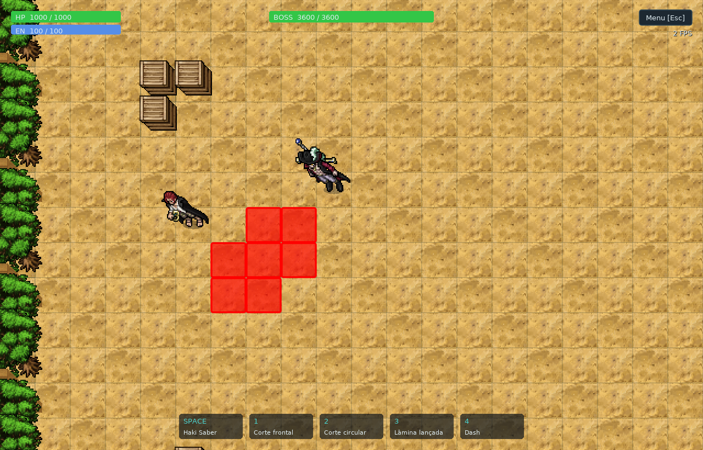
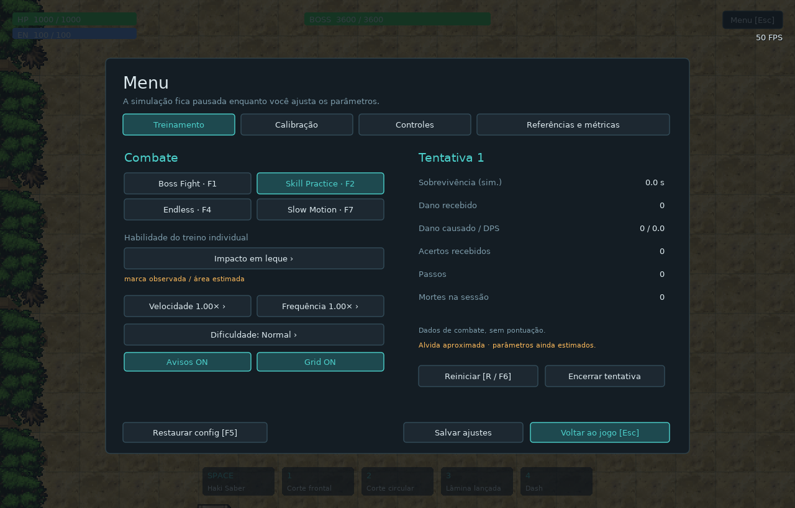
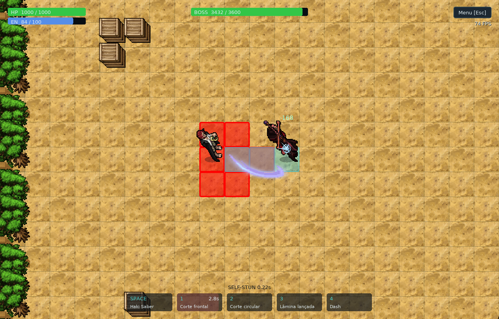

# GLA Boss Fight Simulator

Versão 0.5 jogável, offline, em Lua + LÖVE 11.5. Shanks possui dash na tecla 4; círculos de direção e sistema de pontos foram removidos. HP verde, energia azul, avisos vermelhos, self-stun e sprites fornecidas continuam disponíveis. Arena ocupa toda a janela, com HUD compacto, FPS e menu no Esc. A movimentação mantém a calibração aproximada dos vídeos do Killer com move speed 300; essa velocidade não foi confirmada para Shanks. A meta é reproduzir o GLA com referências, mas o combate ainda contém aproximações documentadas.



Durante a luta aparecem HP, energia, vida do boss, cinco atalhos de habilidades com cooldown e FPS. Modos, frequência, dificuldade, dados de combate, reinício e encerramento ficam na aba **Treinamento** do menu. **Esc abre e fecha o menu**, pausando a simulação enquanto estiver aberto. Tab não abre mais o menu. Calibração, remapeamento e ajuda continuam acessíveis pelas outras abas. O contador usa FPS reais de renderização, inclusive durante pausa e slow motion. Círculos com setas de orientação foram retirados de Shanks e do boss; F3 ainda mostra hitboxes apenas para depuração.





As quatro habilidades ofensivas do Shanks deixam o personagem parado desde o início da execução. A duração total está em `config.lua → playerSkills → selfStun`: básico **0,28 s**, corte frontal **0,45 s**, circular **0,65 s**, projétil **0,40 s**. São estimativas configuráveis, não tempos medidos no GLA. Um passo em andamento fica congelado na posição interpolada e continua após o bloqueio; não há teleporte. Durante o bloqueio, novas skills e mudanças de direção são recusadas; teclas de movimento mantidas pressionadas voltam a funcionar depois. O jogador continua vulnerável. Pausa e slow motion afetam o timer junto com a simulação; cooldown é independente.

O **dash [4]** é uma aproximação pedida para treinamento: **até 3 trechos de SQM**, preparação imóvel de **0,10 s**, **0,05 s por SQM reto / 0,075 s diagonal**, recuperação imóvel de **0,12 s**, custo de **15 de energia** e cooldown de **5 s**. Configure em `playerSkills.dash`. Segue a direção atual, inclusive a definida com Ctrl, para em paredes/entidades e respeita cantos bloqueados. Se usado durante um passo, congela a preparação e conclui rapidamente o trecho atual como primeiro segmento, sem saltar de posição. Bloqueia outras skills durante o deslocamento. Não causa dano nem concede invulnerabilidade; esses comportamentos dependem de confirmação nas referências. O efeito de rastro é apenas visual.

Efeitos animados de corte, giro, impacto e projétil usam PNGs da pasta fornecida. O boss usa uma sprite de espadachim, com os padrões de treino anteriores, ainda baseados nas aproximações de Alvida. Trocar a aparência não significa reproduzir as habilidades oficiais desse personagem. As marcações inimigas usam vermelho saturado no aviso e na execução; não há amarelo nesses avisos.

## Executar no Windows

**Pacote portátil:** extraia `GLA-Boss-Fight-Simulator-Windows.zip` inteiro e abra `GLA Boss Fight Simulator.exe`. Mantenha as DLLs ao lado do EXE. O LÖVE está incluído; não precisa instalar GLA, Lua, Python ou conectar à internet.

**Código-fonte:** com [LÖVE 11.5](https://love2d.org/) instalado, execute no PowerShell:

```powershell
Set-Location 'C:\Users\fakii\Desktop\bossfightsimulator'
& 'C:\Program Files\LOVE\love.exe' .
```

Ou abra `dist\GLA-Boss-Fight-Simulator.love` com o LÖVE. O arquivo `.love` é um ZIP com `main.lua` na raiz. Para editar e calibrar, use a pasta de fontes; alterações nela não modificam o EXE já empacotado.

## Controles padrão

| Ação | Teclas |
| --- | --- |
| Movimentar | WASD, setas ou numpad 2/4/6/8 |
| Diagonais | duas direções simultâneas; numpad 1/3/7/9 |
| Girar sem andar | Ctrl esquerdo ou direito + direção; funciona com WASD, setas e numpad |
| Haki Saber | Espaço; segurar repete quando disponível |
| Corte frontal | 1 |
| Corte circular | 2 |
| Lâmina lançada | 3 |
| Dash | 4 |
| Reiniciar instantaneamente | R ou F6 |
| Pausar / continuar | P |
| Abrir / fechar menu e pausar enquanto aberto | Esc |
| Boss Fight | F1 |
| Skill Practice | F2 |
| Endless | F4 |
| Slow Motion | F7 |
| Hitboxes, estados, grid e tempos | F3 |
| Recarregar config.lua e reiniciar | F5 |
| Próximo padrão individual | [ ou ] |
| Alternar velocidade / frequência | PageUp/PageDown; −/= |

Todos os controles de combate e direção são configuráveis em `config.lua` ou na página **Controles** do menu Esc. Clique numa ação e pressione uma tecla. Ctrl é reservado para girar; Esc e F1–F7 são reservadas à interface. Esc cancela a escolha de tecla quando um remapeamento está em andamento. Tab pode ser remapeado como tecla de gameplay. R e P podem ser usados por habilidades remapeadas; nesse caso, F6 reinicia e Esc permite pausar pelo menu. Teclas de ação usam os nomes do LÖVE (`space`, `kp7`, `up`, etc.); não dependem do repeat do Windows.

Preferências antigas recebem o novo atalho do dash sem perder seus remapeamentos. Se a tecla 4 já estiver usada em outra ação salva, escolha uma tecla para Dash em Esc → Controles; o botão da barra continua disponível.

O ataque básico procura o único boss e gira para ele; seu alcance é radial. As habilidades frontais seguem a direção definida por movimento ou Ctrl + direção e guardam direção/área no início da preparação. Ctrl durante um passo deixa o passo atual terminar e impede o próximo; não teleporta nem interrompe a interpolação. Soltar Ctrl com uma direção ainda pressionada volta a andar. Não há mira pelo mouse nesta versão. Botões da barra também executam as habilidades.

## Movimentação e calibração

- Simulação fixa em **1/120 s**; o FPS de desenho não determina a velocidade.
- Passo reto inicial **0,333333 s**; diagonal **0,666667 s**. A diagonal usa o dobro do tempo, conforme a razão observada no vídeo, sem normalização por sqrt(2).
- Primeiro passo começa no próximo tick após receber o comando. Segurar mantém passos; liberar conclui o passo atual. Um toque curto é preservado mesmo que pressione/solte entre ticks. Há apenas uma intenção recente de direção pendente, sem fila de dezenas de passos.
- O personagem atravessa o SQM com interpolação linear, sem aceleração. A direção pode mudar no próximo SQM. Inputs opostos cancelam o eixo correspondente.
- Paredes, caixas e entidades bloqueiam os passos. Origem e destino ficam reservados enquanto uma entidade anda. Diagonais entre cantos bloqueados são proibidas por padrão, com opção para recalibrar.
- A hitbox acompanha os pés interpolados, inclusive no dash; o sprite não define a área de dano. Não há stamina ou invulnerabilidade automática no jogador padrão.
- Latência opcional atrasa press/release e habilidades em segundos da simulação. É uma aproximação de input, não uma emulação de rede do GLA.

Veja [docs/REFERENCIAS.md](docs/REFERENCIAS.md) para evidências, timestamps e limites da medição. **300 é o atributo informado para Killer**, não uma fórmula que converte automaticamente em pixels/s. O SQM base de 40 px com zoom 1,6× aparece como 64 px no layout 1280 × 820; essa escolha visual não altera o tempo dos passos.

No Esc → **Calibração**, ajuste passos, intervalo extra, latência, tamanho visual do SQM, preparação do leque e câmera. Em `config.lua`, também ajuste HP, energia, defesa, máscaras de alcance, hitboxes, dano, duração, cooldown, recuperação, velocidade de projéteis e rotação. A tabela `provenance` distingue dados informados, estimados e não calibrados.

F5 lê `config.lua` novamente e reinicia a tentativa. O botão **Salvar ajustes** guarda overrides em `settings.lua` no diretório de dados do LÖVE; eles são aplicados no próximo início. F5 ignora overrides salvos na sessão corrente. Para persistir a restauração, pressione **Salvar ajustes** após restaurar.

Janelas redimensionadas mantêm a arena ocupando toda a área, sem faixas pretas de interface. O HUD se ancora nas bordas e o menu fica centralizado. Ajuste o zoom em Esc → Calibração ou em `camera.zoom` (padrão 1,6); `window.scale` é um multiplicador adicional. `config.lua.window.width/height` controlam a resolução inicial; a interface tem referência 1280 × 820 e dimensões mínimas 960 × 615. Câmera acompanha jogador com limites da arena, ou pode ficar fixa. Preferências antigas de câmera preservam o novo zoom padrão.

## Boss e padrões

| Padrão | Uso | Evidência |
| --- | --- | --- |
| Clava | básico direcional, um SQM frontal | animação observada; timing e hitbox estimados |
| Impacto em leque | área frontal de até três SQMs, lentidão | marca em leque observada; dano/área/tempo estimados |
| Clava dupla | dois pulsos com intervalo fixo | padrão provisório de treinamento |
| Projéteis de treino | três lâminas, colisão com paredes e alvo | exercício demonstrativo, não observado em Alvida |

A rotação padrão é clava → leque → clava → combo, **definida para o simulador, não medida como rotação oficial**. Projéteis estão disponíveis em Skill Practice e podem ser acrescentados à rotação em `config.lua`. O boss seleciona o jogador, caminha por SQMs e usa busca de caminho para contornar caixas. Preparação captura direção/área; a sequência dupla mantém a mesma área. Cooldown por habilidade e intervalo entre habilidades são independentes. A frequência do treino divide cooldowns e intervalo, mantendo preparação e execução.

HP, danos, defesa, recuperação e restrições de movimento não estão calibrados à progressão original. Haki Saber tem recarga de 2 s e ganho de 5 de energia, conforme a [wiki de Shanks](https://wiki.gla.com.br/index.php/Shanks). Dano de 65, alcance de 1,45 SQM, preparação de 0,10 s e efeito de corte são aproximações. O ganho ocorre ao acertar nesta implementação; a condição exata não foi confirmada. O poder 15 da wiki não foi convertido diretamente em dano. Os golpes 1–3 continuam exercícios genéricos de treino, sem alegação de reproduzir o kit completo do Shanks. Os grandes efeitos da Yamato não foram atribuídos ao boss sem confirmação. Não há referência de Madera nesta entrega.

## Treinamento e métricas

Boss Fight termina com vitória ou morte. Skill Practice repete o padrão selecionado e recupera HP do boss quando necessário; Endless também recupera HP do boss e continua a rotação. Slow Motion inicia a luta com velocidade 0,5×; o botão alterna 1×, 0,75×, 0,5× e 0,25×. Selecionar Boss Fight, Skill Practice ou Endless restaura 1×, inclusive após reduzir manualmente a velocidade. A tentativa anterior é registrada com seu modo e velocidade anteriores. A dificuldade altera dano/preparação conforme os presets e é uma ferramenta local de treino.

O sistema de pontos foi removido: não há aviso “+1”, contagem de esquivas/falhas ou porcentagem de precisão. A remoção vale para a interface, o resumo e os novos CSVs. São mantidos apenas dados objetivos de combate, sem atribuir uma nota ao jogador.

Ataque básico e habilidades ofensivas do jogador possuem cooldowns e custos próprios. Defesa subtrai dano por acerto, com mínimo zero. Cada área ativa acerta uma vez por alvo/pulso; projéteis usam teste do segmento percorrido, evitando atravessar alvos ou paredes em altas velocidades. Lentidão e stun são estados reutilizáveis. Invulnerabilidade só existe quando configurada; o padrão é zero, inclusive após receber dano.

Esc → Treinamento mostra dano recebido, dano causado, DPS, acertos recebidos, passos, sobrevivência e mortes da sessão. Essas informações não ocupam espaço durante a luta. Tempos de combate e DPS usam segundos da simulação; o relatório também registra tempo real ativo. Pausa/menu não contam. Frames muito longos são limitados a 0,25 s para evitar uma recuperação brusca após travar/minimizar; nesses casos o relógio não tenta alcançar o tempo de parede perdido.

Fim, reinício ou encerramento geram resumo e CSV. `attempts.csv`, `settings.lua` e `test-results.txt` ficam em:

```text
%APPDATA%\LOVE\gla-boss-fight-simulator\
```

No **EXE portátil**, o diretório é `%APPDATA%\gla-boss-fight-simulator\`, sem a pasta intermediária `LOVE`, conforme o comportamento de [jogos empacotados do LÖVE](https://love2d.org/wiki/love.filesystem.isFused). Os dois formatos têm preferências e relatórios separados.

São guardadas até 100 tentativas da sessão no CSV; a sessão seguinte começa nova contagem e exporta o histórico novo. Mortes ficam preservadas entre reinícios e modos na sessão. Avisos coloridos podem ser desligados para treinar a leitura da preparação visual.

## Arquitetura

`main.lua` conecta callbacks do LÖVE, carregamento de configuração e interface. `src/game.lua` coordena os ticks. `movement/dash/input/arena/collision` cuidam dos SQMs, eventos, ocupação e geometria. `combat/skill/player/boss` implementam dano, estados, cooldowns, áreas, projéteis e IA. `training` registra dados de combate sem pontuação. `animation/effects/renderer/hud` desenham sem determinar resultados do combate. `data` descreve os ataques; parâmetros numéricos ficam centralizados em `config.lua`.

O protótipo original foi preservado em `docs/original-main.lua`. Os PNGs selecionados estão incluídos em `assets`, sem depender da pasta Downloads durante a execução. Shanks e boss usam três folhas 128 × 128 cada, com quatro vistas de 64 × 64; diagonais reutilizam vistas cardinais. Frames corporais específicos de ataque e morte não foram identificados: ataque combina pose e sprite de efeito; morte usa a pose esmaecida. Onze texturas de efeitos são animadas em `src/effects.lua`. Chão, caixas e vegetação usam texturas fornecidas; a disposição da arena é própria do simulador. Veja [assets/README.md](assets/README.md) para o inventário e formato do carregador. Sprite, resolução e zoom não mudam o tamanho lógico das hitboxes.

## Referências necessárias para aproximar o jogo do GLA

Prioridade: movimento e dash reais do Shanks, depois habilidades e comportamento de um boss escolhido. Não é preciso enviar tudo de uma vez.

| Material | Como registrar | O que permite calibrar |
| --- | --- | --- |
| Shanks andando | 10–20 s em linha reta, diagonais, toques curtos, troca de direção e Ctrl; mostre move speed, buffs, equipamento, resolução, zoom, FPS e ping | duração dos passos, resposta ao input, escala e câmera |
| Dash do Shanks | 5 repetições reto/diagonal; parado e andando; mirando parede, canto e inimigo; mostre tecla, energia e cooldown | direção/alvo, alcance em SQMs, preparação, recuperação, colisões, dano e possível invulnerabilidade |
| Cada skill isolada | nome e tecla, tooltip completo, 3–5 usos; segure uma direção durante o golpe; teste alvos perto/longe e de lado | self-stun, alcance, hitboxes, custo, cooldown, acertos múltiplos e cancelamentos |
| Boss prioritário | nome, dificuldade e 2–3 lutas completas, preferencialmente solo; trechos parado e desviando, com HP visível | sequência, escolha de alvo, mudanças de fase, velocidade, avisos e momento do dano |
| Sprites e controles | identifique arquivos de personagem/efeito, ordem dos frames e direções quando souber; screenshot dos atalhos e da interface do GLA | animações corretas, tamanho dos personagens, aparência do mapa e controles |

Prefira os arquivos de vídeo originais a 60 FPS ou mais, velocidade normal, sem cortes durante uma ação, sem câmera lenta aplicada na edição e com teclado/atalhos visíveis quando possível. Informe timestamps dos exemplos relevantes. Evite efeitos de outros jogadores nos testes isolados. Nome da skill e tooltip ajudam a distinguir a mecânica de uma coincidência visual. O número de poder exibido não basta, sozinho, para determinar dano final.

Se puder enviar apenas dois materiais agora: **um vídeo do dash do Shanks** e **um vídeo de caminhada com o move speed dele visível**. As durações e regras provisórias serão substituídas conforme essas medições, sem presumir mecânicas do GLA.

## Verificação

Execute testes no runtime real do LÖVE:

```powershell
& 'C:\Program Files\LOVE\lovec.exe' . --test
```

Os testes verificam FPS, oito direções, diagonais, toques curtos, input simultâneo, latência, cantos, entidades, hitbox interpolada, máscaras direcionais, cooldown/energia, defesa/imunidade, projéteis atravessando alvos pequenos, múltiplos pulsos, status, métricas, morte/vitória, treino sem fim, reinício, pathfinding e telas de interface. O processo retorna 0 no sucesso e 1 em falha, com relatório no console e no diretório de dados.

O empacotamento é reproduzível com `python tools/package.py` usando Python apenas durante desenvolvimento. O jogo e o pacote portátil não dependem de Python ou de bibliotecas de vídeo.
